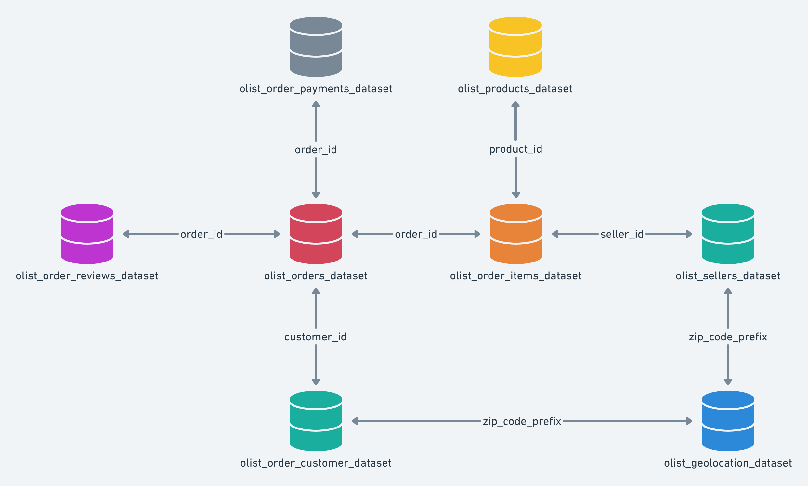

  

<h1 align="center">Brazilian E-Commerce Intelligence Report</h1>
<table align="center">
  <tr>
    <td width="1440">
      <h2 align="center">Client Background</h2>
      <body>
        <strong>Olist</strong> is a Brazilian E-Commerce platform that connects all small and medium-sized business to large online marketplaces, enabling those merchants to list their products and services and customers can browse and purchase them online across brazil through the Olist platform and ship them to the customers using olist logistics partners. It provides tools for order management, logistics, payments, and customer support, helping sellers reach more customers and scale their online business. 
         
        With <strong>100k+ orders, 96k+ customers </strong> and <strong>3,095 sellers</strong> recorded between 2016–2018, this dataset offers a unique opportunity to understand Brazil’s digital commerce ecosystem at scale. The available eCommerce data spans various dimensions and metrics, including sales, products, sales by regions, delivery and customer's review.  
         Reporting to the Head of Operations, an end-to-end analysis was conducted which deep dive across customers, products, sellers, logistics, and revenue, revealing the key drivers behind growth, customer experience, and marketplace performance. Insights from this analysis support strategic decisions in:
        <ul><li>Customer retention
        <li>Delivery optimization
        <li>Category expansion
        <li>Seller performance management
        <li>Marketplace growth planning</ul></li>
      </body>
      <h3>Northstar Metrics</h3>
      <h4>
        <ul><li>Sales trends - Focusing on key metrics of sales revenue, number of orders placed, and average order value (AOV).</li>
        <li>Order Perfromance - Exploring demand patterns, identify seasonal peaks, detect growth signals, and uncover operational timing insights useful for advertising, inventory planning, and staffing.</li>
          <li>Product performance - Analyzing different product categories, market impact, and revenue contribution to inform strategic product decisions.</li>
          <li>Customer Behaviour Analysis - Evaluating the ability of the company to retain customers by understanding how customer groups behave in terms of spending, loyalty, frequency, and value contribution enabling better targeting, retention, and revenue optimization.</li>
          <li>Delivery Performance - Evaluating average delivery days, delay %, and early delivery % to observe it's correlation with satisfaction & churn.</li>
          <li>Seller Performance - Analyzing Top sellers, and how sellers behave across product categories in terms of pricing, market demand and profitabilty helping the marketplace identify categories with strong growth potential</li>
          <li>Average Order Value (AOV) - Analyzing how average order value (AOV) behaves over time and across product categories, uncovering which categories generate high-value baskets, sales volume, and customer purchasing behavior.</li>
        </ul>
      </h4>
    </td>
  </tr>
</table>
<table align="center">
  <tr>
    

      <h1 align="center">Executive Summary</h1>
      <h3 align="center">Sales Revenue Analysis (2017–2018)</h3>
      

        
      

      <td width="460" valign="top">
        <ol>
          <li>
            <strong>Sustained Marketplace Expansion:</strong>
            <ul>
              <li>Olist experienced <strong>strong and consistent growth</strong> from early 2017 through mid-2018, driven by both rising order volumes and increasing total sales. Monthly orders grew from <strong>under 1,000 in early 2017 to 6,000–7,000+ orders per month by 2018</strong>, indicating rapid marketplace adoption and seller expansion.</li>
              <li>Sales followed the same upward trajectory, crossing <strong>R$1M per month</strong> multiple times in 2018, confirming that growth was not driven solely by volume but also supported by stable spending behavior.</li>
            </ul>
          </li>
          <li>
            <strong>Peak Performance & Seasonal Momentum</strong>
            <ul>
              <li><strong>Q4 2017 and Q1–Q2 2018</strong> marked the strongest acceleration phase for the platform.</li>
              <li><strong>November 2017</strong> shows a major spike in both orders and sales, likely driven by <strong>Black Friday and holiday promotions.</strong></li>
              <li><strong>Mid-2018 (Mar–May)</strong> represents a sustained high-performance plateau, with consistently high order volumes and sales above R$900K.</li>
              <li>This pattern highlights Olist’s ability to <strong>capitalize on seasonal demand</strong> while maintaining momentum beyond promotional periods.</li>
            </ul>
          </li>
        </ol>
      </td>
      <td width="460" valign="top">
        <ol start="3">
          <li>
            <strong>Order Growth vs Sales Decoupling</strong>
            <ul>
              <li>While order volume continued to rise steadily into late 2018, sales growth <strong>began to flatten slightly</strong>, particularly after August 2018.</li>
              <li>This divergence suggests:</li>
              <ul><li>A stabilization (or slight decline) in <strong>Average Order Value</strong></li>
              <li>Increased contribution from <strong>lower-priced, high-volume categories</strong></li>
              <li>Possible effects of competitive pricing or promotional discounting</li></ul>
            </ul>
          </li>
          <li>
            <strong>The Q4 2018 forecast projects:</strong>
            <ul>
            <li><strong>A November peak</strong> consistent with historical seasonal trends</li>
            <li>A <strong>soft decline in December</strong>, suggesting post-promotion normalization rather than demand collapse</li>
            <li>Despite short-term volatility, the overall trajectory remains strong, reinforcing the platform’s resilience and scalability.</li>
            </ul>
              <li><strong>Key Takeaways & Recommendations:</strong></li>
              <ul>
              <li>Monitor late-2018 flattening signals by investigating whether AOV pressure is driven by category mix, discounts, or competition and adjust pricing and seller incentives accordingly.</li>
              <li>Double down on Q4 Performance by expanding seller participation and inventory ahead of Black Friday.</li>
              <li>Leverage demand forecasting by using historical seasonality to guide marketing spend and seller onboarding plus align logistics and customer support capacity with forecasted peaks</li>
            </ul>
          </li>
        </ol>
      </td>
    

  </tr>
</table>
<h2 align="center">Dataset Structure and ERD (Entity relationship diagram)</h2>
<body>The database structure as seen below consists of seven tables: orders, customers, seller, products, payments, order_items, reviews, geo_location  with a total row count of 1,12,650 records.</body>

 
  

 
<table align="center">
  <tr>
     <h1 align="center">Order Performance Analysis</h1>
      

        <h3>Product Sales Surged in 2020 but were not Sustained at High Levels</h3>
        
      

    <tr>
  </tr>
</table>
<table aign="center">
  <tr>
      <h3>Trend over Time: Evolution of Orders:</h3>
        E-commerce on Brazil shows strong growth trend from late 2016 to mid-2018, with monthly orders increasing steadily until around mid-2018. This indicates a healthy growth trajectory in customer engagement and online shopping activity this is because customeers are more inclined to shopping online than before. 
         
        ⚠️ There's a noticable dip at the end of timeline from September 2018 onwards is because of the noise on data(incomplete data), For futher comparison between the years 2017 and 2018, let's just consider orders between the months January and August in both years.
         
        <td width="333" valign="top">
        <h3>Noticable Surges and Seasonal Trends:</h3>
        <ul>
        <li>November 2017 and January 2018 - Peak in the orders are likely due to holiday sales, black friday, end-of-year promotions and start of year sales.</li>
        <li>Mid-year (May–August 2018) maintains consistently high volume, suggesting no strong summer dip, unlike in some Western markets.</li>
       
      </td>
  <td width="433" valign="top">
      <h3>Weekly Ordering Patterns: Weekdays vs. Weekends:</h3>
      <ul>
        <li>Customer activity is significantly higher during weekdays, with a peak on Monday (16.29%). Customers appear to prefer ordering at the start of the workweek, potentially using workplace time or planning ahead for the week.</li>
        <li>Weekend activity drops, indicating that leisure or offline activities may reduce online engagement.</li>
      </ul>
      </td>
      <td width="403" valign="top">
      <h3>Time of Day: When Do Customers Place Orders?</h3>
      <ul>
        <li>Most orders are placed in the Afternoon (32.39%) and Night (28.49%), making up over 60% of all purchases.</li>
        <li>Afternoon peaks suggest lunch-hour shopping.</li>
        <li>Night-time orders point to post-work convenience</li>
      </ul>
      </td>
</tr>
</table>
<table align="center">
<tr>
  <h2 align="center">Temporal Trends</h2>
       

      <h3>Weekday Afternoons are Peak Order Times</h3>
      
    

  </tr>
</table>
      <table>
      <tr>
          <ul>
            <li>Every <strong>weekday the high demand consistently</strong> clusters between 10a.m. to 10p.m. with a sharp rise starting at 9 a.m. and <strong>peak intensity usually happens around afternoon 2p.m. to 4p.m.</strong> when customers place orders the most frequently especially Mon-Wed, whcih indicates early-week shoppers show high intent as they research over the weekend and buy at the start of the workweek.</li>
            <li><strong>Thursday & Friday show gradual drop-off slightly</strong> compared to Mon–Wed but still high midday activity peaks around 1p.m.–4p.m. and shows decent traffic until 9p.m. these are still important days, but customers are more selective better suited for targeted, category-specific promotions rather than broad campaigns.</li>
            <li><strong>Saturday & Sunday have lower overall volume</strong> but different behavior patterns, During saturday orders grow later from (11a.m. onward) and stays moderate at afternoon levels and are not as strong as weekdays and also the peaks are softer and more spread out. Whereas, sunday also shows the weakest early-morning activity of the entire week but becomes surprisingly active in late afternoon & evening (4p.m.– 10p.m.) which shows weekend shoppers are more casual as the browsing patterns are less structured and sunday evening is an untapped window for “weekend closing deals”.</li>
          </ul>
      </tr>
</table>
<table align="center">
  <h2 align="center">Orders Comparison Jan-Aug: 2017 vs 2018</h2>
  <tr>
    <td width="1240">
       

      <h3>Explosive YOY Growth (+135%)</h3>
      
    

    </td>
    <td valign="top" width="400">
         
    Explosive Year-over-Year Growth (+135%)
    <ul>
        <li>2017 Jan–Aug orders: 22,968</li>
        <li>2018 Jan–Aug orders: 53,991</li>
        </ul>
        <ul>
        <li>This signals rapid expansion in Brazil's e-commerce and improved site reach marketing efficiency, or operational reliability with strong demand momentum entering 2018. Every month from Jan–Aug 2018 shows 2×–3× higher order volume than the same months in 2017.</li>
        <li>Brazilian consumers show a strongly early-year purchasing cycle brands can leverage this by increasing ad spend, promotions, and inventory availability in Q1–Q2.</li>
      </ul>
    </td>
  </tr>
</table>
<table align="center">
  <h2 align="center">Orders ✕ Seasonability ✕ Revenue Growth Analysis</h2>
  <tr>
       

      
    

    </tr>
</table>
      <table>
      <tr>
    <h4>Low seasonal activity in early 2017:</h4>
    <ul>
        <li>Seasonal indices for the first quarter range from 0.2 to 0.7, reflecting a typical time of slow sales period.</li>
    </ul>
    <h4>Strong seasonal peak from October to December 2017:</h4>
    <ul>
        <li>Revenue indices are somewhat outperform order indices, indicating pricing or product mix impacts during this era, driven by important commercial events such as Black friday, Christmas and New Year sales.</li>
    </ul>
    <h4>Close alignment between order and revenue seasonality:</h4>
    <ul>
        <li>Revenue indices are somewhat outperform order indices, indicating pricing or product mix impacts during this era, driven by important commercial events such as Black friday, Christmas and New Year sales.</li>
    </ul>
    <h4>More consistent seasonality in 2018:</h4>
    <ul>
        <li>Seasonal indices stabilize around 1 (range 0.91 to 1.12), indicating less monthly fluctuation and a maturation towards more stable sales trends with higher baseline order volume and higher revenue index meaning the platform is not just experiencing seasonal spikes; it is growing organically year-over-year.</li>
    </ul>
    </td>
  </tr>
</table>
<table align="center">
  <h2 align="center">Order-Regional Performance Analysis</h2>
  <tr>
       

      
    

    </tr>
</table>
    <table>
      <tr>
        <h3>Southeast is the Economic Engine of Brazilian E-commerce</h3>
          <ul>
            <li>The South eastern region of Brail exhibits the most significant growth in orders, recording an all-time high of 5,933 orders in November 2017.Additionally, a noticable trend of order peaks is observed from October to December across all regions, accompanied by a consistent flow of orders throughout 2018.</li>
            <li>Demand is highly centralized: Undoubtedly, two prominent cities in brazil  are São Paulo the largest city and economic center with the greatest orders of 17,808 and Rio de Janeiro renowned for it's tourism has recorded the second highest orders of 7,837. These two cities alone account for more than half of all national orders. This concentration mirrors Brazil’s population density and economic activity, but also reveals a heavy dependency on just a few states to drive revenue.</li>
          </ul>
        <h3>All Regions Show Growth, but None Come Close to Southeast’s Scale</h3>
          <ul>
            <li>Although North, Northeast, South, and Central-West exhibit consistent year-over-year order growth, their volumes remain significantly smaller. This suggests untapped market potential where targeted marketing or faster delivery could unlock additional demand.</li>
          </ul>  
        <h3>Urban Hubs Dominate Purchase Behavior</h3>
          <ul>
            <li>Cities like São Paulo, Rio de Janeiro, Belo Horizonte, and Brasília lead by a large margin, confirming that e-commerce adoption is strongest in dense metropolitan areas. Mid-tier cities (Campinas, Porto Alegre, Salvador) also show meaningful demand but with slower momentum.</li>
          </ul>  
      </tr>
    </table>
  </tr>
</table>
<table align="center">
  <tr>
     <h1 align="center">Delivery Performance Analysis</h1>
      

        <h3>Over 90% of Orders have been Delivered before Estimated Time</h3>
        
      

    <tr>
  </tr>
</table>
<table aign="center">
  <tr>
  <td width="533" valign="top">
      <h3>Distribution of Delivery Days:</h3>
      <ul>
        <li>Most orders are delivered within 5–20 days, forming a strong right-skewed distribution.</li>
        <li>A small proportion of orders take 40+ days, and a few extreme outliers exceed 100 days, indicating occasional severe delays.</li>
        <li>The core takeaway: delivery performance is generally stable, but long-tail delays exist and inflate customer dissatisfaction risk.
        </li>
        <li>The recommended action is to investigate outlier deliveries to identify whether delays are due to remote locations, seller-side fulfillment lag or carrier inefficiencies.</li>
      </ul>
      </td>
      <td width="533" valign="top">
      <h3>Estimated vs Actual Delivery — Accuracy of Delivery Promises:</h3>
      <ul>
        <li>The histogram of differences is tightly clustered around zero but with a noticeable negative tail: most orders arrive near or slightly before estimate, but a subset experience sizable lateness (again, outliers drive the problem).</li>
        <li>Implication: estimate quality is generally fine, but exceptions (large negative deviations) suggest particular routes/regions need operational fixes.</li>
      </ul>
      </td>
</tr>
</table>
<table align="center">
  <h2 align="center">Average Early vs Delayed Deliveries by Region and States in Brazil</h2>
  <tr>
    <td width="1240">
       

      
    

    </td>
    <td valign="top" width="400">
       
    <ul>
        <li>South-East and Central-West show meaningful early-delivery performance on average, while North and North-East show larger average delays compared with estimates and overall.</li>
        <li>Implication: Logistics capacity and infrastructure differences (distance, infrastructure, carrier coverage) are likely driving systematic regional gaps.</li>
        <li>With a few exceptions, such as Amapa (-73), Roraima (-37), and Acre (-20), which may be due to their mixed cultures of modern and remote areas and underdeveloped infrastructure, all of the states have good average delivery performance (10–20 days) above the estimated time. These states are primarily located in northern brazil, which has experienced the highest delivery delay compared to other regions, as the above regional chart demonstrates.</li>
        </ul>
    </td>
  </tr>
</table>
<table align="center">
  <tr>
     <h1 align="center">Payment Behaviour Analysis</h1>
      

        <h3>Credit Cards are Most Favoured</h3>
        
      

    <tr>
  </tr>
</table>
<table aign="center">
  <tr>
      <td width="333" valign="top">
      <h3>Credit Card</h3>
      <ul>
        <li>Credit cards continued to be the most popular form of payment, rising from 72.6% in 2017 to 74.8% in 2018.</li>
        <li>This modest increase supports its position as the technique with the greatest average spending per order (179 BRL) and validates its dominant position.</li>
        <li>Credit cards are widely used for online transactions because they are fast and secure, allowing customers to complete transactions quickly and with confidence. Additionally, credit cards offer benefits such as rewards programs, cashback, and purchase protection, which can incentivize customers to use them.</li>
      </ul>
      </td>
     <td width="333" valign="top">
      <h3>Baleto</h3>
      <ul>
        <li>Usage of Boleto decreased slightly from 20.4% in 2017 to 18.6% in 2018.</li>
        <li>Customers with substantial purchasing power continue to utilize baleto, as seen by its solid average order value of 177 BRL despite this decline.</li>
        <li>Boletos are another popular payment type in Brazil, especially for customers who do not have access to credit cards or do not feel comfortable using them for online transactions. Boletos are essentially bank vouchers that customers can pay at any bank, post office, or convenience store. They are easy to use and can be used by customers who do not have a bank account or a credit card.</li>
      </ul>
      </td>
      <td width="333" valign="top">
      <h3>Debit Card</h3>
      <ul>
        <li>Among all payment options, debit cards experienced the fastest rise, rising from 0.9% to 1.9% between 2017 and 2018. With an average order value of 149 BRL, its increasing uptake might be a result of a growing number of younger or recently banked consumers.</li>
      </ul>
      <h3>Vouchers</h3>
      <ul>
        <li>Vouchers are the least common option, with usage falling from 6.1% in 2017 to 4.6% in 2018. Additionally, it had the lowest average order value (64 BRL), indicating that it is primarily utilized for promotional or low-value transactions.</li>
      </ul>
      </td>
      <td width="333" valign="top">
      <h3>Installments</h3>
      <ul>
        <li>Installments are a fundamental part of Brazil’s online purchasing culture, a massive share of credit-card transactions use installments — with 1, 2, and 3 installments dominating, and long-tail options extending up to 24 installments. This confirms brazilians prefer spreading payments even for medium-value orders, instalment flexibility drives higher conversion and larger basket sizes, merchants without installment options risk lower purchase completion.</li>
      </ul>
      </td>
</tr>
</table>
<table align="center">
<tr>
  <h1 align="center">Product Performance Analysis</h1>
       

      <h3>Weekday Afternoons are Peak Order Times</h3>
      
    

  </tr>
</table>
      <table>
      <tr>
      <h3>Pricing Pattern</h3>
          <ul>
            <li>The pattern with some categories like (bed_bath_table and furniture_decor), which have low margins but strong volume. This is because the average price of these categories is relatively low (93 BRL for bed_bath_table and 87 BRL for furniture_decor). bed_bath_table, health_beauty, and sports_leisure dominate in both sales volume and revenue, making them the platform’s most stable and reliable growth engines. health_beauty stands out with high demand and premium pricing, suggesting strong brand or product loyalty.</li>
            <li>While Other categories like (watches_gifts, health_beauty) generate high revenue despite lower order volume indicating high average selling prices (ASP) (201 BRL for watches_gifts and 130 BRL for health_beauty) and strong margins.</li>
            <li>Other small categories contributes to overall income without posing significant risk, demonstrating that the corporation efficiently monitizes multiple niches rather than depending on a few standout goods.</li>
          </ul>
      <h3>Business Implication</h3>
          <ul>
            <li>Focus marketing and cross-selling efforts around top categories (health & beauty, home goods) while exploring price optimization and bundling opportunities for premium categories like watches & gifts.</li>
          </ul>
      <h3>Balanced Diversification</h3>
          <ul>
            <li>No single category surpasses the 11% of total revenue and substantially contributes, thus if one segment drops, the entire business impact will be low.</li>
            <li>The corporation avoids reliance on a single product category that may risk income, thus diversification lowers business risks and promotes stable growth.</li>
      </tr>
</table>
<table align="center">
  <h2 align="center">Top 10 and Bottom 10 Product Categories by Revenue Share Growth</h2>
  <tr>
    <td width="1240">
       

      
    

    </td>
    <td valign="top" width="400">
    <ul>
        <li>small_appliances_home_oven_and_coffee shows a massive 4600%+ growth, making it by far the fastest-growing category likely driven by rising household spending and lifestyle upgrades.</li>
        <li>Other high-growth categories such as diapers_and_hygiene and arts_and_craftmanship indicate strong demand shifts toward home & personal care niches.</li>
        <li>Construction-related segments (construction_tools, lighting, signaling, safety) also show consistent positive growth, suggesting strong demand from home-improvement & DIY consumers.</li>
        <li>The bottom 10 categories like fashion and hardware accessories represent obsolete product segments that are declining rapidly and consistently</li>
        <li>Massive Growth implies strong potential for increasing inventory depth, launching targeted campaigns, or forming vendor partnerships in these rapidly growing segments.</li>
        </ul>
    </td>
  </tr>
</table>
<table align="center">
  <tr>
     <h2 align="center">Evolution of High-Value Product Categories YOY</h2>
      

        
      

    <tr>
  </tr>
</table>
<table aign="center">
  <tr>
      <h3>Core Revenue Drivers Stayed Consistent, but Their Weight Shifted</h3>
      Categories like health_beauty, watches_gifts, bed_bath_table, sports_leisure, and computers_accessories continue to sit inside the top 80% revenue band across both years confirming their role as the platform’s revenue backbone. 
      However, several of these core categories experienced material shifts in revenue share, indicating changing customer demand or growing competition.
         
        <td width="400" valign="top">
        <h3>Strong Upward Momentum in Key Categories</h3>
        Several categories grew their revenue share between 2017 → 2018, signalling rising demand:
        <ul>
         
        <li>health_beauty (+2.63 pp) → strongest growth; category expanding rapidly and becoming a top profit driver.</li>
        <li>watches_gifts (+1.59 pp) → high-value gift purchases gaining momentum.</li>
        <li>housewares (+1.66 pp) → consistent growth in household product spending.</li>
        <li>auto (+0.75 pp) & baby (+0.99 pp) → strong upward trend, possibly tied to lifestyle and household expansion.</li>
        </ul>
        Customers are shifting spending toward self-care, home improvement, lifestyle, and premium gifting. These categories warrant deeper inventory investment and promotional prioritization.
      </td>
  <td width="400" valign="top">
      <h3>Decline in Some Previously Strong Categories</h3>
      Certain historically large categories saw a drop in share:
      <ul>
        <li>bed_bath_table (–0.81 pp) → still a major category, but losing relative dominance.</li>
        <li>computers_accessories (–3.14 pp) → big decline; potential price pressure, market saturation, or competition.</li>
        <li>sports_leisure (–0.13 pp) → stable but slightly weakened.</li>
        <li>toys (–2.68 pp) → demand shifting or seasonality no longer strong.</li>
      </ul>
      These categories may require pricing reevaluation, assortment refresh, or targeted marketing to recover share.
      </td>
      <td width="400" valign="top">
      <h3>Products Showing Mixed Trends:</h3>
      <ul>
        <li>computers fell (–2.59 pp) while office_furniture slightly dipped (–1.08 pp).</li>
        <li>Customers appear to be shifting spending away from traditional office/electronic items and toward lifestyle and home-related purchases.</li>
      </ul>
      Small Categories such as pet_shop and stationery are some of the emerging niche opportunites of 2018 which show positive share gains despite small absolute contribution and are worth exploring for future category expansion show positive share gains despite small absolute contribution.
      </td>
</tr>
</table>
<table align="center">
  <h1 align="center">Sales Performance Analysis</h1>
  <tr>
       

      
    

    </tr>
</table>
    <table>
      <tr>
        <h3>Orders and revenue show strong seasonality</h3>
          <ul>
            <li>Growth is volume-driven, with a 7.8x rise in units sold (955 to 7,248) and a 7.5x increase in revenue (R$120,313 to R$854,686). This close match between units sold and revenue implies that growth has been predominantly driven by customer acquisition rather than price strategy.</li>
            <li>Clear monthly uplift across 2017 → peak in Nov (Black Friday) (1M+ BRL) accounts for 18% of all 2017 sales in only one month. Because of this over-dependency, there is a significant level of business risk; if this month underperforms, it might have disastrous effects on annual performance.</li>
            <li>Orders surge continues into early 2018, reflecting year-over-year growth and improved user onboarding.</li>
          </ul>
        <h3>Revenue nearly doubles within 18 months</h3>
          <ul>
            <li>2017 full-year sales: R$ 3.11M</li>
            <li>2018 (Jan–Aug) sales: R$ 7.39M</li>
            <li>137% growth, even without full-year data for 2018 indicates aggressive business expansion & strong customer acquisition.</li>
            <li>The November 2017 peak (1M+ BRL) accounts for 18% of all 2017 sales in only one month. Because of this over-dependency, there is a significant level of business risk; if this month underperforms, it might have disastrous effects on annual performance.</li>
          </ul>  
        <strong>Over the course of five quarters from Jan 2017, revenue increased fourfold from 705K to 2.8M BRL, indicating market expansion and client acquisition throughout this time period.</strong>
          <ul>
            <li>Overall, the business is in a growth stage, not maturity.</li>
            <li>Seasonal spikes are sharp and predictable (strong planning signals).</li>
            <li>Stable performance from early 2018 suggests improved supply chain & customer acquisition.</li>
          </ul>  
      </tr>
    </table>
  </tr>
</table>
<table align="center">
  <tr>
     <h2 align="center">E-Commerce Orders and Sales by Brazil States</h2>
      

        <h3>SouthEast Dominates Order and Revenue</h3>
        
      

    <tr>
  </tr>
</table>
<table>
    <tr>
      <h3>São Paulo is the undisputed demand & revenue hub</h3>
      <ul>
        Highest orders(47k) and highest sales($5M+), with demand levels more than 3× larger than the next state. Acts as the economic engine of Brazilian e-commerce — consistent with population density & purchasing power.
      </ul>
      <h3>Rio de Janeiro & Minas Gerais form the second-tier growth cluster</h3>
      <ul>
        Strong order volume and revenue, but noticeably less than São Paulo. These states represent high-value markets where marketing expansion or logistics investment would yield immediate returns.
      </ul>
      <h3>Southern region states (RS, PR, SC) show strong per-capita performance</h3>
      <ul>
        Although population is smaller than Southeast, their orders-to-sales ratio is stable and healthy. Indicates mature online buying behaviour, especially in PR & RS.
      </ul>
      <h3>North & Northeast have low order/sales volume</h3>
      <ul>
        States such as Acre, Roraima, Amapá, Tocantins contribute minimally. This gap often correlates with lower digital infrastructure, higher logistics costs and Longer delivery times which represents potential markets for targeted last-mile partnerships.
      </ul>
    </tr>
</table>
<table align="center">
<tr>
  <h2 align="center">Sales Volume & Average Spend in Brazil</h2>
    

      
    

    <tr>
</tr>
</table>
<table>
    <tr>
      <h3>Spend vs Revenue (high revenue, low AOV vs low revenue, high AOV)</h3>
      <ul>
        States with very high total sales (e.g., São Paulo, RJ, MG) show low average spend per order, while low-sales states often show higher average spend per order.
      </ul>
      <h3>Order frequency & market maturity:</h3>
      <ul>
        <li>High-sales states are large urban markets with many repeat orders and many low-ticket everyday purchases (higher order count, lower AOV).</li>
        <li>Low-sales states may have fewer orders, but those orders contain higher-priced items (less frequent, higher AOV).</li>
      </ul>
      <h3>Product mix differences:</h3>
      <ul>
        <li>In big states the dominant categories could be low-price, high-frequency categories (e.g., accessories, low-ticket home goods) driving volume. Urban consumers (dense markets) behave differently — many small baskets</li>
        <li>In remote states, purchases may be of higher-value, durable goods (customers buy rarely but spend more per purchase). Rural customers often buy only when needed and consolidate higher-value purchases.</li>
      </ul>
    </tr>
</table>
<table align="center">
<tr>
  <h1 align="center">Customer Behaviour Analysis<h3>RFM Analysis</h3></h1>
  To understand how different customer groups behave in terms of spending, loyalty, frequency, and value contribution — enabling better targeting, retention efforts, and revenue optimization.
    

      
    

    <tr>
</tr>
</table>
<table>
    <tr>
    The table reveals a strong imbalance in value contribution: a small % of customers drives disproportionately large revenue, while the majority contributes low spend and low retention.
      <h3>“One-Time Buyers” dominate customer count but not value</h3>
      <ul>
        <li>They make up 53% of customers yet contribute only 50% of total revenue.</li>
        <li>Their average spend is very low (R$135), meaning they inflate acquisition cost but not long-term value.</li>
      </ul>
        The company is burning acquisition budget on people who never return. 
        Solution: Introduce first-purchase incentives, follow-up campaigns, and cross-sell nudges to convert them into recurring buyers.
      <h3>“Big Spenders” are the revenue backbone despite being only 12% of customers</h3>
      <ul>
        <li>They contribute 33% of all revenue, with 3× higher average spend than most segments.</li>
        <li>But their count is shrinking toward the end of the timeline (seen in the next visual).</li>
      </ul>
      Losing them even slightly has a massive revenue impact. 
      Solution: Immediate retention program (VIP perks, faster delivery, loyalty tiers, personalized emails).
      <h3>“Champions” spend the most per purchase but are extremely few</h3>
      <ul>
        <li>Only 8 customers, yet the highest average order value (R$755).</li>
        <li>Their overall revenue share is tiny simply because there are so few of them.</li>
      </ul>
      This segment has huge revenue upside if expanded. 
      Solution: Look at what categories/products they purchase → build look-alike audience → target with premium bundles.
      <h3>“Hibernating” customers (17% of base) show the highest churn risk</h3>
      <ul>
        <li>Low purchase frequency and long inactivity periods.</li>
        <li>But revenue contribution is not negligible (5%).</li>
      </ul>
      They are recoverable and cheaper to re-activate than new customers. 
      Solution: Dormant-customer win-back program (discount code, “We miss you” reminders).
      <h3>“Need Attention” buyers are the most promising upgrade segment</h3>
      <ul>
        <li>Medium frequency + moderate spend.</li>
        <li>They behave like “almost loyal” customers but aren’t fully retained yet.</li>
      </ul>
      This is the highest-ROI group for up-selling. 
      Solution: Personalized recommendation emails, targeted promotions on categories they frequently explore.
    </tr>
</table>
<table align="center">
  <tr>
     <h2 align="center">Customer Targeting</h2>
     Based on the insights gathered from the customer segment study we will focus on three customer segments for sutomer retention and potential future revenue oppurtunities:
     <h3>Targeted Customer Segments (One-Time Buyers, Big Spenders, New Customers)</h3>
     <strong>One-Time Buyers (53% of customers and 50% of revenue)</strong> 
     <ul>
     High customer churn(one purchase, no loyalty), even though they are high volume customers they are One-Time Buyers so it is necessary to engage with them and reactivate them to retain the customers and thier enormous revenue volume.
     </ul>
     <strong>Big Spenders (12% of Customers, 33% of Revenue)</strong>
     <ul>
     Despite the fact that 50% of revenue comes from One-Time Buyers which is unsustainable, so in order to boost and sustain revenue we need to concentrate on Big Spenders as the small group of customers driving 1/3 of revenue it will make a huge difference if we attempt to persuade them to become loyal customers.
     </ul>
     <strong>New Customers (16% of Customers, 9% of Revenue)</strong>
     <ul>
     New customers are the third in most profitable and big customer base we need to nurture new customers otherwise new customers could become One-Time Buyers.
     </ul>
      

        
      

    <tr>
  </tr>
</table>
<table aign="center">
  <tr>
  <td width="400" valign="top">
        <h3>One-Time Buyers:</h3>
        <ul>
        <li>Spike in Nov 2017: Indicates One-Time Buyers are seasobal buyers coinciding with Black-Friday Sales or Holiday Sales.</li>
        <li>Post-Spike Stagnation: Revenue flatlined despite order growth → Price cuts or low-value purchases.</li>
        </ul>
        This suggests that a large share of the company’s customer base is holiday-driven, discount-driven, or impulse-driven, these people come for seasonal deals and leave. 
        Opportunity: Build re-engagement flows right after peak months.
      </td>
  <td width="400" valign="top">
      <h3>Big Spenders:</h3>
      Certain historically large categories saw a drop in share:
      <ul>
        <li>Late 2017 Takeoff: Their sales curve is smoother and less seasonal and post holiday sales indicating they are need-based, value-driven shoppers — not impulse buyers.</li>
        <li>Fluctuating Sales according to Orders: Medium Average Order Value(AOV) but inconsistent engagement, their order frequency is low (avg 30 days apart) but steady.</li>
      </ul>
      Opportunity: Recommend premium bundles, extended warranties, high-ticket products.
      </td>
      <td width="400" valign="top">
      <h3>New Customers:</h3>
      <ul>
        Fluctuating Sales according to Orders: Even though the orders are high the sales slightly increases and dips according to the orders it shows that that the avgerage spend of new customers is low that's the reason the sales remain stagnant depsite the increasing order value(lookup the previous chart to know the average spend of each customer segments)
      </ul>
      </td>
  <tr>
  <td width="400" valign="top">
        <h3>Customer Lifetime Intervals</h3>
        <ul>
        <li>One-Time Buyers and New Customers have zero-day intervals, They buy once and never come back, the problem is not acquisition but retention.</li>
        <li>Big Spenders have extremely long max intervals (572 days), They disappear for long stretches yet return, they are not loyal, they are high value but inconsistent and are vulnerable to competitor influence.</li>
        Opportunity: Send product reminders every 20–30 days, exclusive member-only benefits.
        </ul>
      </td>
  <td width="400" valign="top">
        <h3>Category Preferences</h3>
        Every segment gravitates toward different product categories
        <ul>
        <li>One-Time Buyers → low-risk essentials (bed_bath_table, health_beauty, sports).</li>
        <li>Big Spenders → premium categories (watches_gifts, health_beauty, furniture-related décor).</li>
        <li>New Customers → household essentials (housewares, bed_bath_table).</li>
        </ul>
        It's obvious that the top three product categories across all three customer segments were health_beauty, and bed_bath_table, which are the two most lucrative product categories. Additionally, the watches_gifts category, which includes luxury goods, is the second most popular sector where Big Spenders want to spend their money. 
        Opportunity: Target each group with category-based recommendations.
      </td>
  <td width="400" valign="top">
        <h3>Review Score Behaviour:</h3>
        Clear correlation: Lower-rated customers receive slower delivery whereas Higher-rated customers receive faster delivery 
        Across all three groups:
        <ul>
        <li>Lower review scores correlate with longer delivery times.</li>
        <li>High review scores correlate with faster delivery.</li>
        </ul>
        Logistic performance directly affects customer satisfaction — not product quality. 
        Opportunity: Improve delivery SLAs for high-value and at-risk segments to prevent churn.
      </td>
  
</tr>
</table>
<table align="center">
  <tr>
     <h1 align="center">Cohort Analysis</h1>
      

        
      

    <tr>
  </tr>
</table>
<table aign="center">
  <tr>
  Cohort analysis reveals that the platform suffers from near-zero retention across all customer cohorts, with less than 1% returning after the first purchase. This pattern is consistent across 20+ months and indicates a structural dependence on acquisition rather than loyalty. To build long-term revenue stability, the business must focus on retention strategies, delivery improvements, and expanding into higher-frequency product categories.”
  <td width="570" valign="top">
      <h3>Retention collapses immediately after the first purchase (0.1%–0.7%)</h3>
      Every cohort begins with 100% at month zero (the purchase month), but retention drops almost instantly to below 1% from Month 1 onward. 
      This means:
      <ul>
        <li>Customers rarely come back after the first order indicates customers treat the platform as a low-frequency necessity</li>
        <li>Repeat purchase behavior is almost nonexistent</li>
        <li>The business is overwhelmingly dependent on constant acquisition</li>
      </ul>
      </td>
      <td width="570" valign="top">
      <h3>Peaks at 0.7% retention show micro-loyalty pockets tied to logistics</h3>
      Small spikes at months 8, 9, 10 and 11 in 2017 appear for some cohorts (0.6%–0.7%).
      <ul>
        <li>This is NOT random maybe due to Black Friday and Holiday Sales or repeat purchase categories expansion and pricing</li>
        <li>Earlier visuals (delivery vs review) showed: Faster deliveries → higher review scores → higher chance of reordering</li>
      </ul>
      This means the micro-retained customers likely received good delivery service and Improving delivery consistency could multiply retention
      </td>
</tr>
</table>
</table>
<table align="center">
<tr>
  <h1 align="center">Customer Churn vs Retenetion Summary Table</h1>
    

      
    

    <tr>
</tr>
</table>
<table>
    <tr>
    “The Olist e-commerce marketplace has an extremely high proportion of one-time buyers (~98%), which is typical for non-subscription retail. Therefore, churn reflects the inherent buying pattern rather than customer dissatisfaction. As a result, churn analysis should be interpreted carefully, focusing on behavioral contrasts rather than causation.”
      <h3>Order frequency is not a churn cause — it is the churn definition itself.</h3>
      The order value distribution is not “churn behavior” but natural buyer lifecycle behavior in online marketplaces. 
      In markets like Brazil’s e-commerce:
      <ul>
        <li>Many customers shop once, often during discounts or specific needs.</li>
        <li>Repeat customers are rare but far more profitable as teir average spending is high.</li>
      </ul>
      <h3>Delivery delay might contribute to churn — but only for a tiny fraction.</h3>
      Since 98% are churned, late delivery cannot explain churn, because nearly all churned customers still had “normal” delivery timelines. Instead, the insight is:
      <ul>
        <li>✔ Extreme late deliveries limit the chance of a customer ever returning</li>
        <li>❌ But on-time delivery does not guarantee retention</li>
      </ul>
      <h3>Is the Churn Analysis Valid? — NO.</h3>
      Because churn analysis requires a balanced sample of churned and retained customers to detect drivers. But the dataset is 98% churned, meaning:
      <ul>
        <li>Almost all feature distributions are dominated by churned users</li>
        <li>Differences are caused by segment size, not behaviors</li>
        <li>The model has no negative examples to learn from</li>
      </ul>
      Instead of trying to “explain churn,” the meaningful question becomes: 
      <strong>“What differentiates the small group of customers who stayed?”</strong>
    </tr>
</table>
<table align="center">
  <tr>
     <h1 align="center">Seller Performance Analysis</h1>
      

      <h3>Marketplace Seller Segmentation</h3>
        
      

    <tr>
  </tr>
</table>
<table aign="center">
  <tr>
  <h3>Non Linear Relationship but Inverse:</h3>
  The plot clearly shows more sellers ≠ more revenue but shows inverse relationship where many high-seller categories deliver lower avg revenue per seller and some low-seller categories deliver very high avg revenue due to demand dilution, Market saturation reduces revenue per seller, but not uniformly — category demand shapes the curve.
  <td width="333" valign="top">
      <h3>Neglected Hidden Gems:</h3>
      Categories such as computers generate over (R$25000) and watches_gifts (R$12000), and Office Furniture (R$8000) in average stand out as major “Hidden Gems" with exceptionally high revenue compared to others but with very few sellers indicate low competition + strong demand — the best mix for growth., These markets are under-penetrated and represent the highest ROI opportunity for new sellers.
      </td>
      <td width="333" valign="top">
      <h3>Rising Stars:</h3>
      Mid-sized clusters such as computers_accessories, toys, garden_tools, and cool_stuff shows moderate to high competition (200-300 sellers) with Mid-to-high average revenue per seller (R$3000-6000) these products offers profitable growth potential and these markets have healthy demand and room for differentiation, the remarkable product of this segment is health_beauty which maintains over R$5,000 despite 500+ sellers.
      </td>
      <td width="333" valign="top">
      <h3>Miscellaneous Saturation Traps:</h3>
      Categories like Furniture Decor, Auto, Housewares, Sports & Leisure show very large number of sellers ranging from (0-500) with low to moderate average revenue per seller (R$1000-2000). These markets are oversaturated, new sellers entering these segments will face intense competition, lower margins, lower revenue per seller as these categories behave like commodity markets. Sellers flood the category because of perceived demand, but only a few succeed hence marketplace should avoid onboarding more sellers here and instead improve product differentiation and promote high-quality or premium alternatives
      </td>
      <td width="333" valign="top">
      <h3>Low-Yield Niches</h3>
      Categories like fashion_shoes, kitchen, home_appliances, luggage_accessories, audio have few sellers (~60) with very low avg revenue per seller (R$<1000), These categories suffer from weak market demand and limited revenue opportunity for sellers and market entry here brings minimal upside. This segment is not ideal for investment or seller recruitment; should focus instead on cross-selling strategies, bundling and seasonal or targeted campaigns.
      </td>
</tr>
</table>
<table align="center">
  <tr>
     <h2 align="center">Top Sellers: Strength Through Category Focus</h2>
     To study how top sellers achieve high revenue — whether they dominate a single high-value category or distribute their sales intelligently across multiple segments.
      

        
      

    <tr>
  </tr>
</table>
<table aign="center">
  <tr>
  <h3>Top Sellers Tend to Specialize Rather Than Diversify:</h3>
  <ul>
  <li>Most high-performing sellers generate the majority of their revenue from one dominant product segment (often above 80–95% share). and avoid high competition saturation traps category where atmost 2 sellers achieve decent success ranging from (66-87% share) and operating across 10 different categories, demonstrating that competing in saturated markets require operational scale.</li>
  <li>This suggests that top performers win either by dominating one profitable niche or strategically balancing their portfolio across growth categories while avoiding overexposure to saturated or low-margin segments.</li>
  </ul>
  <h3>Hidden Gems Are the Most Profitable Strategic Segment</h3>
  <ul>
    <li>Multiple sellers show high revenue concentration in the “Hidden Gems” category (80%–99%), indicating high revenue potential, low competition. Sellers who discover these products can strongly outperform others, Sellers relying on Hidden Gems often pair them with small contributions from Rising Stars, indicating an expansion strategy. These sellers tend to fall into a "Specialized" and “Focused growth” position, scaling a proven high-margin niche.</li>
    <li>The marketplace strategy is to identify these categories and onboard more sellers thus increase product vareity without risking saturation.</li>
  </ul>
  <h3>Rising Stars Act as an Expansion Channel, Not a Primary Revenue Driver</h3>
  <ul>
    <li>Rising Stars appear mostly at 5–30% contribution levels, they rarely dominate revenue but often accompany a strong core category. This indicates that sellers use Rising Stars for future-proofing and testing emerging demand.</li>
  </ul>
  <h3>Saturation Traps Still Matter — But Only for a Few Sellers</h3>
  <ul>
    <li>A small subset of top sellers relies heavily (50–80%+ revenue) on Saturation Traps these sellers operate in highly competed product segments where margins risk erosion, This pattern is risky and too much categories may add to pricing pressure or commoditization.</li>
    <li>The marketplace strategy is to encourage these sellers to expand into Rising Stars and Hidden Gems to reduce churn risk and improve marketplace profitability.</li>
  </ul>
  <h3>Low-Yield Niches Remain Minimal</h3>
  <ul>
    <li>No top seller relies on these niches as a primary source — they are support categories, not profit engines. confirming these represent truly low-potential markets that should only serve as supplementary revenue streams.</li>
    <li>The marketplace strategy is to stop pushing these categories for seller acquisition and instead reclassify or merge them.</li>
  </ul>
</tr>
</table>
<table align="center">
  <tr>
     <h2 align="center">Seller Pricing and Category Behaviour Analysis</h2>
     To understand how sellers behave across product categories—both in terms of pricing and assortment width—and identify structural differences between one-time sellers and multi-order sellers.
      

        
      

    <tr>
  </tr>
</table>
<table aign="center">
  <tr>
  <td width="580" valign="top">
    <h3>One-time sellers consistently price higher in most categories</h3>
      <ul>
      <li>One-Order Sellers Drastically Overprice in 35 Categories  (nearly 2x more than multi-order sellers) — Mostly in Saturation Traps exactly where the market punishes them the most (electronics, auto, appliances, toys) which is the worst possible place to overprice where competitors dominate. Their pricing spikes cause no repeat orders huge overpricing in categories like computers (5,139 BRL), home appliances (1,065 BRL), art (1,110 BRL) show complete misalignment with real demand.</li>
      <li>This pattern suggests one-time sellers enter the platform with inflated, experimentation, or opportunistic pricing.</li>
      <li>Higher prices → lower conversion → sellers make only a single sale → appear as “one-order sellers”. Hence overpricing is a major driver behind one-time sellers not returning.</li>
      </ul>
      </td>
  <td width="580" valign="top">
    <h3>Multi-order sellers maintain stable, category-anchored pricing</h3>
      <ul>
      <li>Multi-Order Sellers average prices follow a consistent, narrower band,— Strategically in Low-Competition or Value-Adding Niches more in low yield niches and some in rising stars such as (agro_industry_and_commerce, musical_instruments, health_beauty, perfumery) these sellers raise prices only where buyers are value-oriented, not price-sensitive and they are selectively premium never random. They know the competitive price floors and keep prices lower in 80–90% of categories and raise prices only in categories where customers care about quality (books_general_interest, perfumery, music, musical instruments).</li>
      <li>Higher sales velocity → more orders → appear as multi-order sellers. Hence pricing discipline is a predictor of sustained seller performance.</li>
      </ul>
      </td>
      </table>
    The Underlying Consumer Behavior Pattern is consumers tolerate high prices when product quality matters (musical instruments, perfumery, health_beauty, books), the product is differentiated (Hidden Gems or Rising Stars) whereas, consumers do not tolerate high prices when the product is standardized, competition is high, electronics are involved. 
    Seller retention is lost due to fundamental misunderstanding of segment elasticity and price sensitivity, If new sellers were guided on pricing benchmarks per segment, retention would increase immediately.
    </tr>
</table>
<table align="center">
  <tr>
     <h2 align="center">Seller Engagement Pattern</h2>
     <h4>Niche vs Diversified Sellers and their Category Prefrences</h4>
      

        
      

    <tr>
  </tr>
</table>
<table aign="center">
  <tr>
  <td width="580" valign="top">
    <h3>Most sellers operate in a single category (1,728 sellers)</h3>
    <ul>
    <li>This indicates that the marketplace is dominated by niche-focused sellers rather than broad catalog sellers. Most sellers enter the market with narrow specialization and involvement declines drastically as complexity rises. This implies that rather than being big shops, the majority of Olist vendors are small, specialized companies.</li>
    <li>But niche focus may come with risk such as Limited diversification and Lower cross-category discovery.</li>
    </ul>
  </td>
  <td width="580" valign="top">
    <h3>The number of sellers declines sharply as category range expands</h3>
    <ul>
    <li>The largest obstacle that sellers encounter on the site is the enormous 59% drop-off that occurs when they attempt to expand from one to two categories (1,689→690). With notable decreases ranging from 37% to 57%, each expansion stage is still difficult, but the difficulty fluctuates rather than following a regular pattern.</li>
    <li>Only 282 sellers (9%) successfully operate across five or more categories, indicating that most sellers lack the necessary resources or platform expertise.</li>
    </ul>
    </td>
    </table>
    The marketplace struggles not because of low seller participation, but because of seller misalignment. Most sellers enter with just 1 category and select extremely competitive segments—then overprice their products. Meanwhile, our most successful sellers diversify across 3–20 categories, price correctly, and position themselves in Rising Star categories that reward assortment and trust. 
    To grow marketplace performance, we must guide new sellers toward smarter category choices, diversified portfolios, and competitive pricing strategies. The data makes it clear: success is achieved not by specialization, but by strategic breadth.”
    </tr>
</table>
<table align="center">
  <tr>
     <h1 align="center">Average Order Value (AOV) Analysis</h1>
     To analyze how Average Order Value (AOV) behaves over time and across product categories, uncovering which categories generate high-value baskets, and identifying macro patterns linking AOV, sales volume, and customer purchasing behavior.
      

        
      

    <tr>
  </tr>
</table>
<table aign="center">
  <tr>
  <td width="580" valign="top">
    <h3>Strong seasonal spikes in sales do not correspond to high AOV</h3>
    <ul>
      <li>Sales peak sharply around Nov 2017 → Black Friday then again at Mar–May 2018 and Nov 2018 (forecast), Early 2017 sales are below R$ 400K per month and by late 2018, sales regularly exceed R$ 800K–R$ 1M, This shows strong year-over-year growth and increasing customer demand, yet AOV declines or stays flat during these periods. Peaks in AOV do not always align with peaks in sales. AOV ranges roughly between 125 and 150 BRL.</li>
      <li>This indicates high sales are volume-driven (more orders), not value-driven. Customers buy more items, but the average basket size remains modest, typical of promotional cycles.</li>
      </ul>
  <td width="580" valign="top">
    <h3>AOV peaks occur in low-volume months</h3>
    <ul>
    <li>Major AOV spikes appear in Jan 2017, Apr 2017 and Sep 2018(forecast), these are usually months when demand is stable or slightly declining thus higher-priced categories (e.g., electronics, home appliances) drive purchases.</li>
    <li>Customers tend to make big-ticket purchases when not influenced by promotions or seasonal rush. Promotional seasons attract more low-value orders.</li>
    <li>However 2018 maintained consistently higher AOV after mid-year. The trendline shows AOV stabilizes around 130–150 BRL which indicates healthier basket composition vs 2017 suggests better product mix, possible improvement in seller offerings</li>
    </ul>
    </td>
</tr>
</table>
<table align="center">
  <tr>
     <h2 align="center">Product Category Value Matrix</h2>
      

      <h3>High-Value Niches vs Mass-Volume Categories</h3>
        
      

    <tr>
  </tr>
</table>
<table aign="center">
  <tr>
  The inverse relationship between AOV and order volume reflects natural marketplace economics:
  <ul>
  <li>High-demand = low-AOV, low-demand = high-AOV.</li>
  </ul>
  <td width="420" valign="top">
      <h3>High AOV, Low Volume (Premium Niche Categories)</h3>
      Premium categories such as Computers, Small appliances / home oven and coffee, Home appliances 2, Agro_industry_and_commerce have very high AOV (400–1200 BRL+) but low order volume, these categories behave like high-margin, low-frequency purchases. Even with fewer orders, they significantly lift revenue.
      </td>
      <td width="420" valign="top">
      <h3>Low AOV, High Volume (Mass-Market Drivers)</h3>
      <ul>
      <li>Mass-Market categories namely Bed_bath_table, Health_beauty, Sports_leisure, Computers_accessories, Furniture_decor drives the highest order counts but average AOV stays between 100–200 BRL. These categories sustain the platform’s daily demand and their revenue is volume-driven—not margin-driven.</li>
      <li>This aligns with broad appeal, consumer necessity, Lower price points, Heavy competition → price compression.</li>
      </ul>
      </td>
      <td width="420" valign="top">
      <h3>Mid-range AOV, Moderate Volume (Core sustainable categories)</h3>
      Sustainable categories such as Office_furniture, Musical instruments and Auto sit near or slightly above the average line and deliver balanced performance (neither niche nor mass-market extremes). Hence, these are stable and reliable contributors – not dependency risks and not niche categories.
      </td>
</tr>
</table>
<table align="center">
  <tr>
     <h2 align="center">Order Volume & Average Order Value by Brazilian States</h2>
      

        
      

    <tr>
  </tr>
</table>
<table aign="center">
  <tr>
    <h3>Dominant Markets:</h3>
    SP (~41k+ orders) generates massive demand far higher than any other state even without a high AOV (R$126), likewise MG and RJ (~11.5K - ~12.7K) generates lower volume than SP but higher AOV(R$137-143), this indicates large customer base and high frequency purchases revealing a price-sensitive mass market that drags down overall profitability, so with small increase in AOV via upsells and focusing on scaling through marketing and logistics would produce major revenue uplift due to volume.
    <h3>Mid Tier States showing Balanced Performance:</h3>
    States like RS, PR, SC, BA, DF, ES, GO generates order volumes between (~2k and ~6k) and AOVs mostly in the (R$ 145–170) range. These states are stable and reliable contributors with potential for regional campaigns, targeted promotions, improving customer retention.
    <h3>Premium Markets - High AOV Low Volume States:</h3>
    Certain states stand out due to high AOV but very low order volume which includes, PB (~R$ 210 AOV) – extremely high, AP (~R$ 198 AOV), RR (~R$ 160–180 AOV), AC (~R$ 195 AOV), But they have only ~50–600 orders. These are high-value customers but niche markets with limited reach or poor logistics coverage, more focus needed on strengthening ad targeting and explore personalized offers as these customers spend significantly more.
    <h3>Northern and Remote States Lag in Order Volume:</h3>
    States like RO, AM, AP, RR, AC has very low order volume (< 500) but moderate to high AOV values, Low demand is likely due to shipping challenges or limited e-commerce adaption.
</tr>
</table>
  
<table align="center">
    <h1>Recommendations</h1>
    <h4>Based on the uncovered insights, here are actionable items that Olist can take away from our analysis.</h4>
        <h3>Shift Growth Strategy from Acquisition to Retention-Led Revenue</h3>
        <strong>Why?</strong> 
        The cohort and retention analysis shows that ~98% of customers are one-time buyers, yet retained customers wo places 2× more orders and spend ~92% more per customer 
        <strong>Action:</strong>
        <ul>
        <li>Introduce post-purchase re-engagement flows (email / marketplace notifications) targeting customers after their first successful delivery</li>
        <li>Incentivize second purchase with:</li>
          <ul><li>Category-specific coupons</li>
          <li>Free or discounted shipping on the next order</li></ul>
        <li>Prioritize retention efforts in high-volume states (SP, RJ, MG) where logistics reliability is already strong</li>
        <li>Implement basic loyalty programs or first-purchase follow-ups to convert new customers into repeat buyers.</li>
        </ul>
        <strong>Business Impact:</strong> 
        Even a 1–2% increase in repeat customers would materially increase GMV without additional acquisition cost.
        <h3>Rebalance Category Strategy: Protect AOV While Scaling Volume</h3>
        <strong>Why?</strong> 
        Your AOV vs Order Volume analysis shows a clear tradeoff:
        <ul>
        <li>High-volume categories (e.g., health_beauty, housewares) drive scale but dilute AOV</li>
        <li>High-AOV categories (e.g., computers, watches_gifts) are under-leveraged in volume</li></ul>
        <strong>Action:</strong>
        <ul>
        <li>Bundle low-AOV, high-volume items with complementary add-ons in high-volume but low-AOV states (SP, MG) to improve profitability.</li>
        <li>Promote high-AOV categories during seasonal peaks (Q4, promotions)</li>
        <li>Focus campaigns on high-AOV states (DF, PB, AM) to maximize revenue per order.</li></ul>
        <strong>Business Impact:</strong> 
        Stabilizes revenue growth when order volume plateaus and protects margins at scale wit new growth opportunities.
        <h3>Strengthen Seller Ecosystem by Promoting Category Focus or Smart Diversification</h3>
        <strong>Why?</strong> 
        Seller performance analysis reveals:
        <ul>
        <li>Top sellers either dominate a single strong category or diversify across multiple profitable categories</li>
        <li>Many sellers fall into “saturation traps” with high competition and low revenue per seller</li>
        </ul>
        <strong>Action:</strong>
        <ul>
        <li>Incentivize sellers to move into underserved but high-yield categories</li>
        <li>Expand seller acquisition in high-efficiency, underpenetrated states in the Northeast (e.g., Maranhão, Bahia).</li>
        <li>Penalize over-saturated low-yield segments through reduced visibility and encourage sellers to diversify carefully into Rising Stars or Hidden Gem categories</li>
        </ul>
        <strong>Business Impact:</strong> 
        Improves seller profitability and reduces platform noise from low-yield listings.
        <h3>Regional Pricing & Freight Strategy Optimization</h3>
        <strong>Why?</strong> 
        We uncovered a strong pattern in customer spending across different states:
        <ul>
        <li>High-sales states → lower average spend</li>
        <li>Low-sales states → higher average spend</li>
        </ul>
        Same inverse pattern observed for freight costs
        <strong>Action:</strong>
        <ul>
        <li>Introduce region-aware pricing and promotions</li>
        <li>Subsidize freight in high-potential but underpenetrated regions</li>
        <li>Encourage sellers in high-sales regions to upsell via bundles instead of discounts</li>
        </ul>
        <strong>Business Impact:</strong> 
        Unlocks growth in underserved regions while improving revenue efficiency in mature markets.
        <h3>Align Marketing & Operations with Proven Seasonality</h3>
        <strong>Why?</strong> 
        Sales and orders peak consistently during Q4 and early Q1, driven by seasonal demand. 
        <strong>Action:</strong>
        <ul>
        <li>Front-load seller onboarding and inventory readiness before Q4</li>
        <li>Prepare targeted campaigns for Q4 peaks (Black Friday, holiday season) to maximize sales.</li>
        <li>Lock logistics capacity ahead of peak months</li>
        <li>Run early campaigns or use incentives instead of reactive promotions during low-season months to maintain more consistent order volumes.</li>
        </ul>
        <strong>Business Impact:</strong> 
        Maximizes peak-season revenue while reducing operational stress and delivery failures.
</table>
  
<table align="center">
    <h1>Limitations</h1>
    <h3>Partial Historical Coverage</h3>
    Only 2017 contains a full year of data, while 2016 and 2018 are partial years. As a result, long-term trend analysis and seasonality interpretations—especially forecasts—should be treated as directional rather than definitive.
    <h3>Uneven Regional & Customer Distribution</h3>
    The dataset is heavily concentrated in major states such as São Paulo (SP) and consists predominantly of one-time buyers (~98%). This imbalance may bias trends toward high-volume regions and first-time customer behavior, making it harder to generalize insights across all states or customer segments.
    <h3>Lack of Behavioral & Marketing Signals</h3>
    The dataset does not include customer demographics, browsing behavior, marketing attribution, or promotion data. This limits deeper analysis of conversion drivers, pricing sensitivity, and campaign effectiveness.
    <h3>Data Quality Corrections</h3>
    Several invalid records (e.g., shipping dates occurring before purchase dates) required correction through estimation. While necessary for consistency, these adjustments introduce minor assumptions that could affect delivery-related metrics.
    <h3>Missing or Imputed Product Attributes</h3>
    Some product-level attributes (dimensions, weight, photos count) contain missing values and were imputed or selectively excluded based on analysis relevance. This may slightly reduce precision in logistics- or product-specific insights.
    <h3>Seller–Product Concentration</h3>
    A large proportion of sellers operate within a single product or category, limiting the ability to compare diversified versus specialized seller strategies across the platform.
    <h3>Outliers & Skewed Distributions</h3>
    Order values, freight costs, and Average Order Value (AOV) exhibit significant skewness and outliers. Although mitigated where possible, extreme values may still influence averages, causing certain categories or sellers to appear more or less profitable than they truly are.
    <h3>Incomplete Customer Feedback Data</h3>
    Review comment fields (review_comment_title, review_comment_message) contain a high proportion of missing values. While review scores were retained, the lack of textual feedback limits deeper sentiment analysis and qualitative understanding of customer dissatisfaction.
</table>

